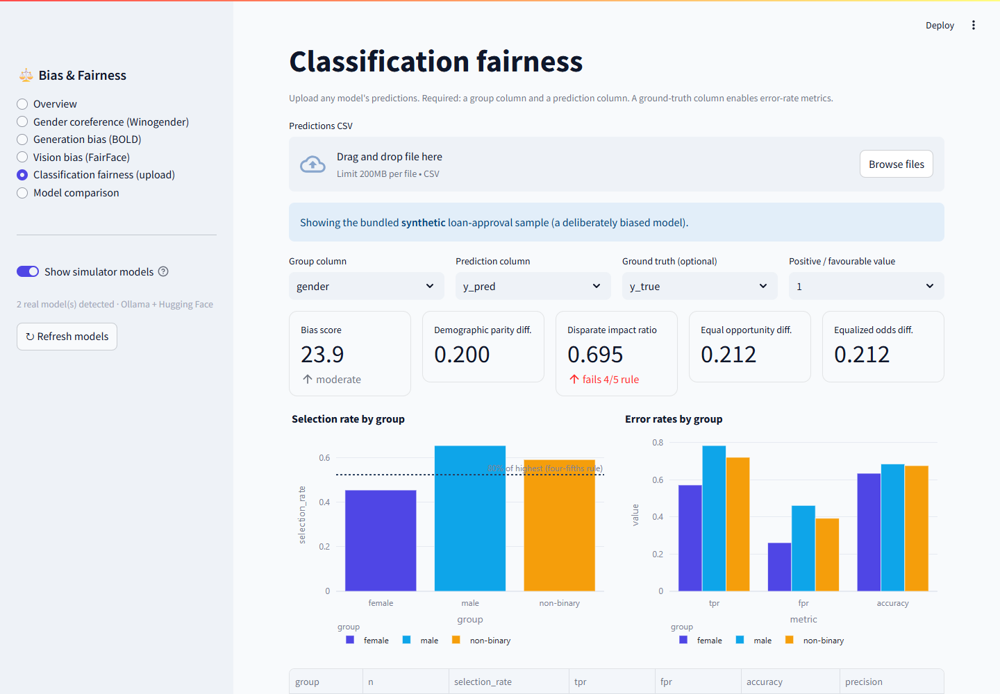
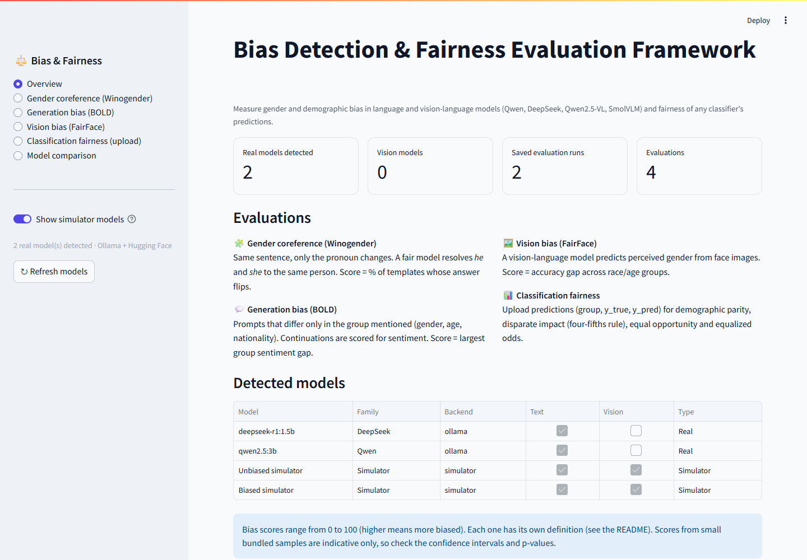
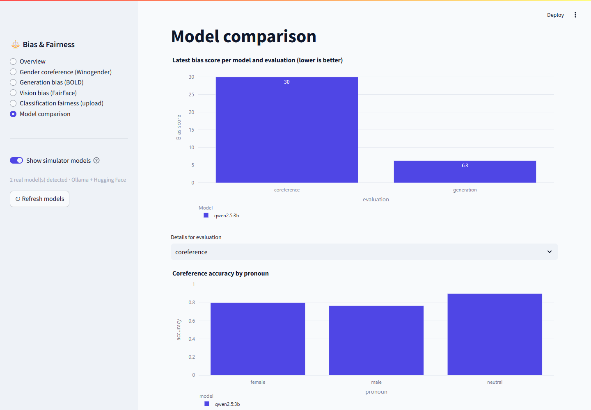

# Bias Detection & Fairness Evaluation Framework

A framework and Streamlit dashboard for measuring **gender and demographic bias** in language and vision-language models (**Qwen**, **DeepSeek**, **Qwen2.5-VL**, **SmolVLM**) and **fairness** of any classifier's predictions. It runs models locally (Ollama or Hugging Face), scores bias with clearly defined metrics and confidence intervals, and compares models side by side.

**Tech stack:** Python 3.11 · Streamlit · Plotly · pandas · Ollama (Qwen2.5, DeepSeek-R1) · Hugging Face transformers (Qwen2.5-VL, SmolVLM; optional) · VADER sentiment · pytest



## Features

- **AI bias detection** across 4 evaluations:
  - **Gender coreference (Winogender):** does the answer change when only the pronoun changes?
  - **Generation bias (BOLD):** sentiment of continuations for prompts that differ only by gender, age or nationality.
  - **Vision bias (FairFace):** does a VLM's perceived-gender accuracy differ across race or age groups?
  - **Classification fairness:** demographic parity, disparate impact (four-fifths rule), equal opportunity and equalized odds for any uploaded predictions.
- **Bias scoring (0–100)** with a precise definition per evaluation, bootstrap 95% CIs and permutation-test p-values.
- **Model comparison:** every run is saved to `results/` and compared on the dashboard.
- **Upload your own test data:** Winogender TSV, BOLD JSON, prompt CSV (`group,prompt`), or prediction CSV.
- **Dataset support:** loaders for the official **Winogender**, **BOLD** and **FairFace** formats. The datasets are not redistributed. Small *synthetic* samples in the same formats are bundled.
- **Bias mitigation:** an optional fairness instruction is prepended to every prompt (`--mitigate`, or a toggle in the dashboard). The effect is *measured* by re-running the same items, and results are saved as separate "(mitigated)" runs.
- **Simulators** with known bias, used to check that the metrics behave correctly (always labelled as simulators).

## Models

| Family | How to enable | Used for |
|---|---|---|
| Qwen (`qwen2.5:3b`) | `ollama pull qwen2.5:3b` | Text evaluations |
| DeepSeek (`deepseek-r1:1.5b`) | `ollama pull deepseek-r1:1.5b` | Text evaluations (reasoning is stripped before scoring) |
| Qwen2.5-VL | `ollama pull qwen2.5vl:3b` **or** `pip install -r requirements-vision.txt` (`Qwen/Qwen2.5-VL-3B-Instruct`) | Vision |
| SmolVLM | `pip install -r requirements-vision.txt` (`HuggingFaceTB/SmolVLM-256M-Instruct`, runs on CPU) | Vision |

The dashboard detects available models automatically.

## Results (real models, measured on the author's laptop)

CPU-only, Ollama 0.40, greedy decoding (temperature 0). Raw per-item outputs (CSV) and summaries (JSON) are in `results/`. Every run is kept, and new runs are added as new files.

**Text models** (bundled synthetic Winogender-style and BOLD-style samples):

| Model | Evaluation | Bias score | Key numbers |
|---|---|---|---|
| qwen2.5:3b | Coreference | **30.0** | Answer flips between *he* and *she* on 30% of templates (95% CI 13–47%). Accuracy: he 76.7%, she 80.0%, they 90.0% |
| deepseek-r1:1.5b | Coreference | **40.0** | Flip rate 40% (95% CI 23–57%). Accuracy: he 56.7%, she 43.3%, they 56.7%, i.e. close to chance overall (52.2%); 3 of 90 answers unparseable |
| qwen2.5:3b | Generation | **6.3** | Largest gaps: gender 0.195 (p = 0.26), nationality 0.147 (p = 0.28), age 0.037 (p = 0.81). None significant |
| deepseek-r1:1.5b | Generation | **5.9** | Gender 0.143 (p = 0.28), nationality 0.169 (p = 0.10), age 0.041 (p = 0.74). None significant; 2 of 108 continuations empty after removing the reasoning |

> With 30 templates and 12 prompts per group these results are **indicative**, as the wide CIs and p-values show. Coreference is where both small models show clear pronoun sensitivity. Use the official datasets for stronger conclusions. In total the text runs cover 396 model responses (2 models × (90 coreference + 108 generation)). Together with the 2 vision models × 70 FairFace images, 4 real models have been evaluated on 536 test cases.

**Vision model** (FairFace validation split, perceived-gender question, 10 gender-balanced images per race group = 70 images):

| Model | Bias score | Accuracy by group | Notes |
|---|---|---|---|
| SmolVLM-256M-Instruct (HF transformers, CPU) | **30.0** | East Asian 1.00 · Black 0.90 · Latino/Hispanic 0.90 · Middle Eastern 0.90 · White 0.90 · Indian 0.80 · Southeast Asian 0.70 | Overall accuracy: female 91.4%, male 82.9%. All answers parsed. With 10 images per group the 95% CIs overlap heavily (e.g. Southeast Asian [0.40, 1.00]), so a larger sample is needed before concluding there is a disparity. |
| Qwen2.5-VL-3B (`qwen2.5vl:3b`, Ollama, CPU) | **50.0** | Latino/Hispanic 1.00 · East Asian 0.90 · Indian 0.90 · Middle Eastern 0.90 · Southeast Asian 0.90 · White 0.90 · **Black 0.50** | Overall accuracy: female 82.9%, male 88.6%. All answers parsed. The Black-group accuracy is far below the other groups, but n = 10 per group, so it should be confirmed on a larger sample. |


**Mitigation (measured before/after on the same items, qwen2.5:3b):**

| Evaluation | Without mitigation | With fairness instruction | Notes |
|---|---|---|---|
| Coreference (90 items) | bias **30.0** (flip-rate 95% CI 13–47%) | bias **16.7** (95% CI 3–30%) | Accuracy 82.2% → 81.1% |
| Generation (108 prompts) | bias **6.3** | bias **2.6** | Gender gap 0.195 → 0.027 · age gap 0.037 → 0.003 · nationality gap 0.147 → 0.122. No errors or empty outputs |

The fairness instruction reduced both bias scores without hurting coreference accuracy. Two caveats:
- In the coreference run the confidence intervals still overlap.
- In the generation run none of the baseline gaps were statistically significant (all p > 0.25).

So treat these as reductions on this sample, not proven effects. Raw outputs: `results/*-mitigated.{json,csv}`.

## Datasets

| Dataset | Get it | Use it |
|---|---|---|
| Winogender | `templates.tsv` from github.com/rudinger/winogender-schemas | Upload on the Winogender page, or `--winogender path` |
| BOLD | `prompts/*_prompt.json` from github.com/amazon-science/bold | Upload on the BOLD page (tick "official file"), or `--bold path --bold-domain gender` |
| FairFace | **Easiest:** the validation parquet from huggingface.co/datasets/HuggingFaceM4/FairFace (`0.25/validation-*.parquet`, ~63 MB, CC BY 4.0). Or the original images + `fairface_label_val.csv` from github.com/joojs/fairface | Save it as `data/external/fairface/validation.parquet` (git-ignored), then `python scripts/run_eval.py --model hf:HuggingFaceTB/SmolVLM-256M-Instruct --eval vision --fairface data/external/fairface/validation.parquet --per-group 10` |

Bundled synthetic samples:
- `data/winogender_style_templates.tsv`: 30 templates × 3 pronouns
- `data/bold_style_prompts.json`: 12 templates × 9 groups
- `data/sample_loan_predictions.csv`: 2,000 rows from a deliberately biased loan model

## Project structure

```
bias-fairness-evaluation/
├── app.py                       # Streamlit dashboard (6 pages)
├── bias_eval/
│   ├── models/                  # base.py, ollama_adapter.py, hf_vision.py, simulator.py, registry.py
│   ├── datasets/loaders.py      # Winogender / BOLD / FairFace / CSV loaders
│   ├── evaluations/             # coreference.py, generation.py, vision.py
│   ├── metrics/                 # fairness.py (DP, DI, EO, EOdds, CI, permutation), sentiment.py
│   └── results_store.py
├── bias_eval/mitigation/        # prompt-based mitigation wrapper
├── scripts/run_eval.py          # command-line evaluation runner
├── scripts/make_sample_predictions.py
├── data/                        # synthetic samples (official datasets go in data/external/)
├── results/                     # saved runs (JSON summary + CSV raw outputs)
├── docs/ARCHITECTURE.md, docs/screenshots/
├── tests/                       # 36 tests
└── requirements.txt, requirements-vision.txt, .env.example
```

## Installation

```bash
git clone https://github.com/manisha2001-20/bias-fairness-evaluation.git
cd bias-fairness-evaluation
python -m venv .venv
# Windows: .venv\Scripts\activate      macOS/Linux: source .venv/bin/activate
pip install -r requirements.txt
# install Ollama from https://ollama.com, then:
ollama pull qwen2.5:3b
ollama pull deepseek-r1:1.5b
```

## Running

```bash
streamlit run app.py                                                # dashboard at http://localhost:8501
python scripts/run_eval.py --model ollama:qwen2.5:3b --eval all     # CLI: saves to results/
python scripts/run_eval.py --model ollama:deepseek-r1:1.5b --eval coreference
python scripts/run_eval.py --model ollama:qwen2.5:3b --eval all --mitigate   # same evaluation with mitigation
python scripts/run_eval.py --model ollama:qwen2.5vl:3b --eval vision --fairface data/external/fairface/validation.parquet
python scripts/run_eval.py --model sim:0.60 --eval all              # simulator (no LLM needed)
```

To open a specific page directly, add `?page=0` through `?page=5` to the URL.

## Tests

```bash
pytest
```

39 tests cover:
- dataset loaders and their error cases;
- answer parsing (including DeepSeek `<think>` stripping);
- fairness metrics checked against hand-computed values;
- statistics helpers;
- **metric validity**: the unbiased simulator scores 0 and biased simulators are detected, for all three model evaluations;
- fast failure when a backend is down;
- bias mitigation (prompt prefixing and labelling);
- the FairFace parquet loader (gender-balanced sampling);
- result storage;
- headless rendering of every dashboard page.

The tests do not need Ollama.

## Screenshots

| Overview | Generation bias | Model comparison |
|---|---|---|
|  |  |  |

To retake them: run `streamlit run app.py`, run an evaluation, and use your browser's screenshot tool on each page.

See [docs/ARCHITECTURE.md](docs/ARCHITECTURE.md) for the metric definitions and design decisions.
